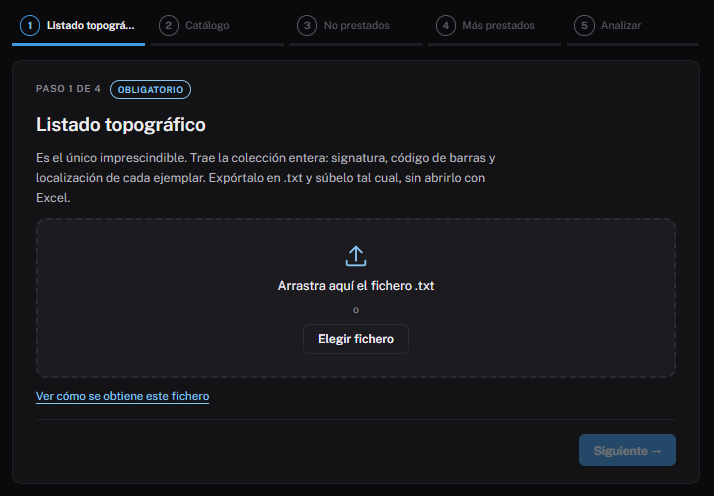
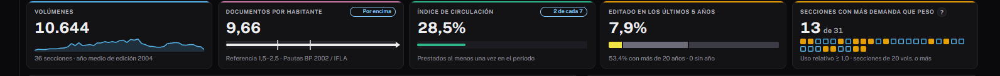

# Tu primer diagnóstico

En este recorrido harás el análisis completo de tu biblioteca, de la
exportación de AbsysNet al informe en PDF. Calcula unos **veinte minutos**.

**Necesitas:** acceso a AbsysNet y Bildumargi instalado en tu ordenador (ver
[Instalar en Windows](../administracion/instalar-windows.md)).

## 1. Exporta los listados

En AbsysNet, exporta estos cuatro listados **en formato `.txt`**. Solo el
primero es imprescindible, pero con los cuatro el análisis es completo:

1. Listado topográfico de ejemplares.
2. Catálogo.
3. No prestados.
4. Más prestados.

Cómo obtener cada uno: [Exportar los listados de AbsysNet](../uso/exportar-absysnet.md).

!!! warning "No los abras con Excel"
    Guarda los ficheros tal cual salen. Si los abres y los guardas con Excel,
    se pierde el formato de columnas y Bildumargi no los reconocerá.

## 2. Abre Bildumargi y responde cuatro preguntas

La primera vez, Bildumargi empieza con una **puesta en marcha** de cinco
pasos. Cada uno dice si es **obligatorio** u **opcional**:

| Paso | Qué pide | ¿Obligatorio? |
|---|---|---|
| Biblioteca | Nombre de la biblioteca y de su red | El nombre, sí |
| Población | Código postal y municipios que atiende (habitantes del INE) | No |
| Catálogo de la red | Si tienes el fichero del catálogo (`.db`) y dónde está | No |
| DILVE | Si tienes cuenta, usuario y contraseña | No |
| Listados | Resumen y paso a la primera carga | Sí |

Lo que respondes se guarda al pasar de paso y se puede cambiar después en
**Configuración** (rueda dentada, arriba a la derecha).

## 3. Carga los ficheros

Al terminar la puesta en marcha verás el asistente de carga, que pide un
fichero por pantalla.

1. Arrastra el **listado topográfico** al recuadro, o pulsa **Elegir fichero**.
2. Pulsa **Siguiente** y repite con el catálogo, los no prestados y los más
   prestados. Si te falta alguno, pulsa **Omitir**.
3. En la última pantalla revisa el resumen y pulsa **Analizar colección**.

La primera vez, Bildumargi apunta el código de sucursal de tus listados. Si te
equivocas de paso al subir un fichero, lo detecta por su contenido y lo coloca
en su sitio.

Si en la puesta en marcha no indicaste el código postal, escribe los
habitantes en **Configuración**, apartado **Tu biblioteca**: sin la población
no hay documentos por habitante.

## 4. Lee el diagnóstico

Al terminar se abre la pestaña **Diagnóstico**. Fíjate en tres cosas:

- **Los indicadores de arriba**: volúmenes, documentos por habitante frente a
  la referencia, índice de circulación y porcentaje editado en los últimos
  cinco años.
- **El gráfico de secciones**: cuánto pesa cada sección en el fondo y su
  **uso relativo**. Un 1,0 significa que rinde lo que pesa; por encima,
  rinde más; por debajo, menos. El «?» junto al dato lo explica.
- **La lectura automática**: un texto que resume lo más destacado.

Más detalle en [Diagnóstico](../uso/diagnostico.md).

## 5. Explora una sección

Abre la pestaña **Secciones** y pulsa un rectángulo del mapa (cuanto más
grande, más volúmenes; el color indica el uso). Verás sus años de edición,
sus localizaciones y la lista de ejemplares, que puedes descargar en CSV.

## 6. Imprime el informe

Pulsa **Informe**, junto a **Cambiar ficheros**. Se abre una vista previa en
hojas A4 con todo el análisis. Pulsa **Imprimir o guardar PDF** y elige
«Guardar como PDF».

Este informe es útil para justificar el presupuesto ante el ayuntamiento:
explica cada dato y su fuente.

## Y ahora

- Con una cuenta de DILVE, mira [Sugerencias de compra](../uso/sugerencias-compra.md)
  y [Series](../uso/series.md).
- La próxima vez no hace falta volver a subir los ficheros: en la pantalla de
  inicio, **Abrir el último análisis**.
- Repite el análisis cada cierto tiempo: [Seguimiento](../uso/seguimiento.md)
  te enseña la evolución y las **altas y bajas** de cada vez.
